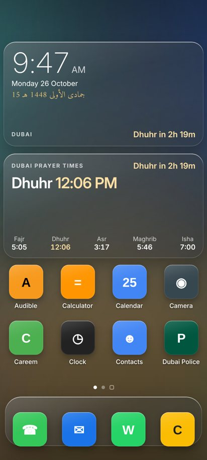
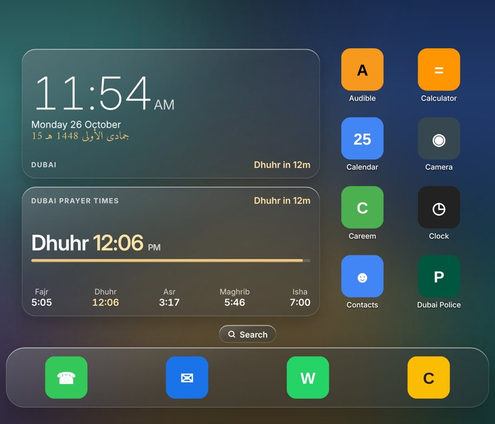
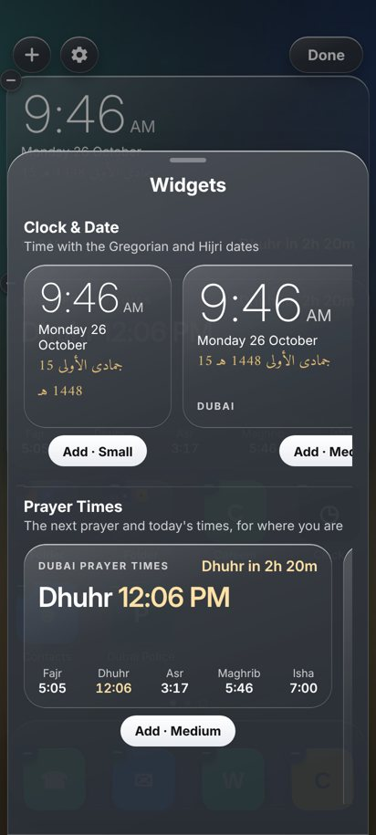
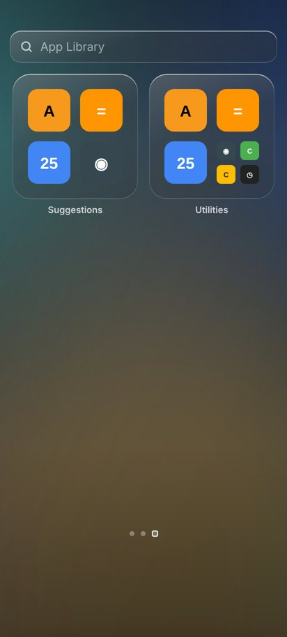

# MK TV & Car Launcher

An Apple TV–style home screen and Islamic dashboard screensaver (with the M&D logo) for Google TV / Android TV, and a smooth touch home screen with azkar and Sharjah prayer times for Android car head units, in a Liquid Glass look.

Two APKs are built from the same code:

| APK | For | Home screen |
|---|---|---|
| `mk-tv-launcher.apk` | Google TV / Android TV 9+ | Apple TV style, remote control |
| `mk-car-launcher.apk` | Android car head units 8+ (made for 12" screens, e.g. 1920×720) | Azkar, Sharjah prayer times, app drawer; touch first |
| `mk-phone-launcher.apk` | Android phones 8+, foldables too | iPhone-style pages, widgets and drag and drop |


| Screensaver | Prayer alert |
|---|---|
|  |  |
| **Folder** | **Night mode, Friday reminder** |
|  |  |

## Features

**Home screen**
- Apple TV layout: apps five to a row, a soft glow in the selected app's brand colour, glass capsule with clock, Wi-Fi and Settings.
- **Hold OK** on an app (or press Play/Pause) for a small glass menu: **Move**, **Add to Folder**, **Hide**, **Delete** (apps you installed).
- **Folders** like Apple TV: glass tiles previewing up to nine apps, named automatically (Entertainment, Games, Sony…), with Rename, Move and Remove Folder.
- Smooth on TV hardware: every tile is GPU-composited and only transform/opacity animate.

**Screensaver**
- Clock, Gregorian and Hijri date, weather now and for 4 days (Open-Meteo, no API key).
- **Finds where the TV is by itself**: time and dates follow the TV's time zone, the city comes from its internet connection (TVs have no GPS), and prayer times use the official method for that country (UAE Awqaf, Umm al-Qura, Egyptian, Karachi/Hanafi, Diyanet, JAKIM, ISNA, and more). You can fix the place and method yourself instead.
- Prayer times are calculated on the TV and keep working offline.
- **Silent prayer alert**: "Asr in 10 minutes", then "It's time for Asr" in Arabic and English. No sound.
- Azkar by time of day: morning (4 AM–12 PM), general (12–5 PM), evening (5 PM–4 AM), from Hisn al-Muslim.
- **Night mode** dims everything between Isha and Fajr.
- **Friday** Surat Al-Kahf reminder (Thursday Maghrib to Friday Maghrib) and **white days** fasting reminder (Hijri 12–15).
- Optional two-city world clock and your own logo text at the top.
- Backgrounds: your **shared Google Photos albums** (new photos appear by themselves) mixed with 10 bundled nature scenes.

## Car head unit (`mk-car-launcher.apk`)

A smooth, touch-first home screen for the car (made for 12" screens such as 1920×720), in Liquid Glass. Previews with placeholder app icons:


- **Home**: the time (and M&D logo, Gregorian and Hijri dates, Friday / white days reminders), an **azkar widget** (morning, general or evening azkar by the time of day; tap for the next one) and **prayer times for where the car is** (from its GPS, with the official method of that country), next prayer highlighted.
- **Silent prayer banner**: 10 minutes before each prayer a soft glass banner ("Asr in 10 minutes"), then "It's time for Asr" in gold, in Arabic and English. No sound, no vibration. When another app is in front (navigation, music), the same words come as a silent notification banner that goes away by itself.
- **Day / Eye comfort / Night** buttons (top of the time card). **Night mode comes on by itself at Maghrib** and day mode at sunrise; tap ☀ to go back to day whenever you like (your choice holds until the next sunrise or Maghrib). The modes lower the screen brightness while the home screen is shown and lay a warm tint over it; other apps keep the system brightness.
- **Split screen**: the **Split** button in the sidebar opens two apps side by side (for example Google Maps + YouTube). Tap **New Pair**, pick the two apps (1 on the left, 2 on the right), then **Open Side by Side**; the pair is saved in the Split menu for next time (up to 6 pairs; **Remove a Pair** deletes one). The launcher first tries a direct split, which works on many Android 9 head units. If the apps open one after the other instead of side by side, install the small optional helper **`mk-split-helper.apk`** (same Releases page) and switch it on once: Split → **Turn On Split Helper** → *MK Split Screen* → On (Settings → Accessibility). It only presses the system's split-screen action and reads nothing on the screen. It is a separate app because some head units refuse to install apps that include an accessibility service; if yours refuses the helper, the launcher still works. With the helper on, pressing **Home** while two apps are side by side closes the split and shows the home screen full screen (otherwise Android 9 keeps a strip of the first app at the side).
- **Favorite places** (under the azkar), opened in **Google Maps** only: **Home** and **Work** go to the places saved as Home and Work in your Google Maps (sign in to Google Maps on the head unit with your account; hold either to use another place instead), **Mosque** and **Petrol** (the nearest ones around the car).
- **Qibla** button: a compass with the Kaaba marked that turns with the car (from the head unit's compass, or the GPS direction once the car is moving), e.g. "Qibla 40° to your right", plus the distance to Makkah. Standing still without a compass it shows the direction from north.
- **Travel dua** (دعاء السفر): when a trip starts — a navigation app opened from the home screen, sidebar, drawer or favorites — the azkar card shows the travel dua in Arabic for 15 minutes (tap it to go back to the azkar), and a silent banner shows it over the map. At most once an hour.
- **Arabic interface**: the ع / EN button on the time card switches everything (menus, dates, prayer times, banners) to Arabic, with the layout mirrored.
- **Sidebar**: time, **Wi-Fi**, up to 4 apps **you choose**, **Settings**, and the **App Drawer** button. Hold an app in the drawer → **Add to Sidebar** (or **Remove from Sidebar**); hold an app in the sidebar → **Move Up / Move Down / Remove from Sidebar**.
- **App Drawer**: every app in pages, **swipe** sideways. Like the TV home, **hold** an app for the glass menu: **Move**, **Add to Folder**, **Hide**, **Delete**; the app being moved jiggles: drag it (hold it at the screen edge to change page) or tap where it should go, then **Done**. Folders open as a glass platter; hold a folder to **Rename**, **Move** or **Remove Folder**.
- **No screensaver** in the car version.
- **Smooth on head units**: the Liquid Glass wallpaper is pre-blurred, so nothing is blurred while you swipe; only transform and opacity animate; the app list is re-read only when an app is installed or removed; the page ignores the system font size.
- Adapts to 1920×720, 1280×720, 1024×600 and portrait screens. Steering-wheel / rotary buttons that send arrow and OK keys work too (hold OK for the menu).
- On first start the app asks for **location** permission (allow it, for prayer times that follow the car). Without GPS, or until the first fix, it uses Sharjah (UAE Awqaf). To fix a place instead, set `latitude`, `longitude`, `city` (and `prayer`) in settings.

**Install**: copy `mk-car-launcher.apk` to a USB stick, open it with the head unit's file manager and allow installing from that source. If it says *"There was a problem parsing the package"*:
1. Check the file is complete (about 4.9 MB; a half-finished download won't open).
2. Allow installing for the app you open it with: Settings → Apps → (your file manager or browser) → *Install unknown apps* → Allow. On Android 8 and later, a file manager without this permission gets exactly this error.
3. Copy the APK from the USB stick to the head unit's internal storage and open it from there, or open it with another file manager (*Files by Google*, *X-plore*); or download it straight on the head unit with Chrome from the Releases page and open it from Chrome's downloads. Then press **Home** and choose *MK TV & Car Launcher* → **Always** (or Settings → Apps → Default apps → Home app). If the head unit has adb over Wi-Fi, the `tv.sh` install and settings commands work with `CAR=1` in front, e.g. `CAR=1 ./tv.sh install`, `CAR=1 ./tv.sh settings settings.json`.

## Phone (`mk-phone-launcher.apk`)

The matching home screen for your phone, in the same Liquid Glass look, laid out like an iPhone:

| Folded | Unfolded | Widgets | App Library |
|---|---|---|---|
|  |  |  |  |

- **Home pages** you swipe through, with a glass **dock** at the bottom and a **Search** pill above it (the page dots show while you swipe). Every app sits on a page (new ones go to the last page) unless you remove it from the Home Screen. App icons look like an iPhone's: round or odd-shaped Android icons are made into full rounded squares.
- **Search**: swipe down on any home page (or tap Search): suggestions, apps as you type, and *Search the web*.
- **App Library** after the last page, like iOS: boxes for Suggestions, Recently Added and each kind of app (Social, Entertainment, Utilities…); tap a box's small icons to see all of its apps; tap the search field for every app A to Z.
- **Arrange like an iPhone**: hold an app for its menu (*Edit Home Screen*, *Remove from Home Screen*, *Delete App*), or hold and drag to start editing: everything jiggles, the other apps slide out of the way as you move, hold at the screen edge to change page (past the last page makes a new one), drag into or out of the dock. Hold an app over another app's icon to make a **folder** with both (over a folder's icon to add it in; apps only slide aside when you're between icons); in a folder, drag to reorder or out of the glass to take it out; a new folder opens straight away with its name ready to type, and in edit mode you tap any folder's name to rename it. Drag apps from the App Library onto a page. Tap **Done** (or an empty spot) to finish; empty pages go away.
- **Widgets**: in edit mode tap **Edit → Add Widget** for the gallery: **Clock & Date** (with the Hijri date and next prayer), **Prayer Times** (next prayer, or the full list), **Azkar** (tap for the next), **Qibla** (turns with the phone; tap for the full compass), **Places** (Home and Work from your Google Maps, nearest mosque and petrol), **Weather**; in small, medium, large or wide sizes. **Islamic** widgets, all liquid glass: the **M&D logo** (with the Hijri date; on the first page by default), **Hijri Calendar** (days to Ramadan, Eid, Arafah, Ashura), **Next Prayer** ring countdown, **Tasbih** (tap to count 33 / 33 / 34, with a daily total; hold for *Reset Counter*), **Verse of the Day** (tap for another), **Names of Allah** (one of the 99 each day, with its meaning), **Sunnah Reminders** (Monday/Thursday and White Days fasts, Friday Al-Kahf, Duha, the last third of the night, Dhul-Hijjah, Shawwal). Also **Dua of the Day**, **Hadith of the Day** (with sources), **Prayer Tracker** (tick off the five prayers, with a streak), **Quran Khatma** (+1 page / +1 juz towards 604 pages), **Iftar & Suhoor** countdown and **Moon Phase**.
- **Resize widgets**: in edit mode tap the corner handle of a widget for its next size, or hold it and pick Small / Medium / Large / Wide.
- **Place things anywhere**: drop an app or widget on an empty part of a page and it stays exactly there (nothing gets packed to the top). Drag widgets to the screen edge to move them to another page.
- **Other apps' widgets**: **Edit → Add App Widget** lists every widget on the phone (Gmail, Calendar, Spotify, weather...) with its preview. Android asks once to allow MK Launcher to add widgets, then the widget's own setup if it has one. They work live on the page, can be resized and moved, and a hold on one opens its menu. Drag them around like apps; the minus badge removes one.
- **Foldables**: the grid follows the screen as you fold, unfold or turn it: 4 columns on a phone or the folded screen, 6–8 unfolded, without reloading; apps that no longer fit move to the next page. Upright on phone-sized screens, any way round on big ones.
- **Prayer**: times for where you are (GPS), a soft silent banner before and at each prayer (also over other apps), Arabic or English (**Edit → Customize** in edit mode).
- **Smooth**: the Liquid Glass wallpaper is pre-blurred so nothing is blurred live; tiles move with transform only; finger movement is applied once per frame.

Install: open `mk-phone-launcher.apk` on the phone (allow installing from your browser or file manager) and open it: it asks to be your **Home app** (Android's own dialog, or the Home app settings if the phone has stopped showing it). *Not now* asks again a day later; it's also in **Edit → Customize → Home app**. It's a separate app from the car one, with its own layout. App widgets of other apps (e.g. Gmail's) aren't supported; the widgets are the launcher's own.

## What you need

- A Google TV or Android TV running Android 9 or newer.
- A Mac or Linux computer on the same network (for `adb`, used to install and to make it the Home screen).

## Install

1. **Get the tools** (adb, and JDK + Android SDK if you build yourself):
   ```bash
   tools/setup-sdk.sh
   ```
2. **Turn on debugging on the TV**: Settings → System → About → press OK on *Android TV OS build* 7 times. Then Settings → System → Developer options → **USB debugging** on. Note the TV's IP address (Settings → Network).
3. **Connect** and accept the prompt on the TV (tick *Always allow*):
   ```bash
   ./tv.sh connect 192.168.1.50
   ```
   If your TV shows *Wireless debugging* with a pairing code instead: `./tv.sh pair <tv-ip> <port> <code>`, then `./tv.sh connect <tv-ip> <port>`.
4. **Install** the APK from the Releases page (or build it, see below):
   ```bash
   ./tv.sh install mk-tv-launcher.apk
   ./tv.sh set-home
   ./tv.sh screensaver on
   ./tv.sh delay 2
   ```
5. **Optional, make it yours**: location and prayer method are detected automatically. To add a logo or world clocks, or to fix the place and method, copy `settings.example.json` to `settings.json`, edit it, then:
   ```bash
   ./tv.sh settings settings.json
   ```

## Your photos in the screensaver

In Google Photos, open an album → **Share** → **Create link**, then:

```bash
./tv.sh albums add https://photos.app.goo.gl/XXXXXXXX
```

The TV re-reads the albums every 6 hours. `./tv.sh albums list | remove <link> | clear` manage them. Set `"mixScenes": false` to show only your photos.

> Google stopped letting apps read albums through its API in March 2025, so this reads the album's public share page. It works today, but Google could change that page.

Prefer local files? `./tv.sh photos <folder>` pushes a folder of images instead.

## Settings

All keys are optional; anything left out uses the default in [`app/assets/config.js`](app/assets/config.js).

| Key | What it does |
|---|---|
| `latitude`, `longitude`, `city` | Fix the place instead of detecting it (detection is the default) |
| `timezone` | IANA zone; default `"auto"` uses the TV's own time-zone setting |
| `prayer` | Fix the method instead of the country's official one. A `prayer` block replaces the detected method entirely |
| `prayer.fajrAngle`, `prayer.ishaAngle` | Twilight angles (e.g. 18.2/18.2 UAE, 18/17 MWL, 19.5/17.5 Egypt) |
| `prayer.ishaMinutes` | Isha a fixed time after Maghrib (Umm al-Qura: 90) |
| `prayer.asrFactor` | 1 = Shafi'i/Maliki/Hanbali, 2 = Hanafi |
| `prayer.offsets` | Minutes added per prayer, to match your local authority |
| `logoText` | Text at the top of the screensaver and on the car home (default `"M&D"`); `&` is drawn in gold; `""` hides it |
| `worldClocks` | List of `{ "city", "zone" }` (IANA time zones) |
| `prayerAlert` | `enabled`, `minutesBefore`, `minutesAfter` (TV screensaver and car banner) |
| `nightAuto`, `nightLevel` | Car only: night mode from Maghrib to sunrise (default on), and how dark (1 eye comfort, 2 night) |
| `nightMode` | `enabled`, `dim` (0–1) |
| `reminders` | `kahf`, `whiteDays` |
| `azkar` | `morningFrom`, `generalFrom`, `eveningFrom` (hours) |
| `homeOrder`, `homeExclude` | Starting app order, and apps never shown |
| `useAlbums`, `mixScenes`, `photoSeconds`, `albumRefreshHours`, `weatherMinutes` | Screensaver photos and refresh |

## Remote

| Where | Button | Does |
|---|---|---|
| Home | OK / hold OK | Open app or folder / options menu |
| Home | Up from the top row | Wi-Fi and Settings |
| Options menu | Left / Right, OK, Back | Choose, pick, close |
| Move | Arrows, OK | Move the app, done |
| Folder | Back | Close the folder |

## Going back to the stock home screen

```bash
./tv.sh restore
```

Without a computer: Settings → Apps → See all apps → Show system apps → **Google TV Home** → Enable (and **Setup**), then press Home. Remove the app from Settings → Apps → **MK TV & Car Launcher** → Uninstall.

## Build from source

```bash
tools/setup-sdk.sh
./build.sh          # out/mk-tv-launcher.apk and out/mk-car-launcher.apk (or ./build.sh tv / ./build.sh car)
./tv.sh install
```

No Gradle: `build.sh` uses `aapt2`, `javac`, `d8` and `apksigner` directly. The UI is plain HTML/CSS/JS in [`app/assets/`](app/assets) shown in a WebView (`home.html` and `screensaver.html` on TV, `car.html` in the car); the two APKs differ only in their manifest ([`app/AndroidManifest.xml`](app/AndroidManifest.xml), [`car/AndroidManifest.xml`](car/AndroidManifest.xml)), whose `flavor` picks the home screen; [`Bridge.java`](app/src/com/mk/homedash/Bridge.java) is the small Android side (apps, launching, network, location, albums).

Releases are built by GitHub Actions: every push builds both APKs (download them from the run's *Artifacts*); pushing a tag like `v2.0.0`, or a new `versionName` in `app/AndroidManifest.xml` reaching `main`, builds them, signs it with the key kept in the repository's encrypted secrets, and publishes the release. Your own local builds use a key created in `keystore/`, so uninstall a release before installing your own build (or the other way round).

Tested on a Sony BRAVIA 4K VH2 (Google TV, Android 12).

## Credits

See [CREDITS.md](CREDITS.md). MIT licensed, see [LICENSE](LICENSE).
